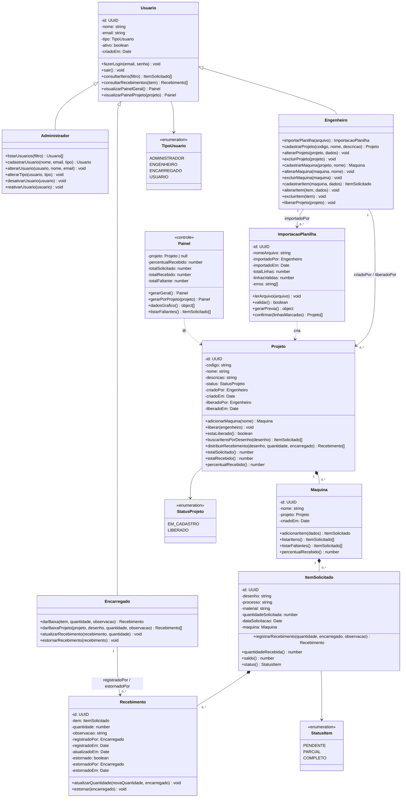

# CONTEXT.md — eCheck

> Documento de contexto para o Claude Code. Reúne todas as decisões tomadas até 25/11/2026 sobre o eCheck: problema, casos de uso, arquitetura, estrutura de pastas, diagrama de classes, regras de negócio, regras de exceção e especificação de cada caso de uso.
> **Este arquivo é a fonte da verdade.** Em caso de dúvida, siga o que está aqui; se algo não estiver definido, pergunte antes de decidir.

---

## 1. O problema e o objetivo

Na Rotex Máquinas, a engenharia sabe exatamente o que pediu para Compras, mas não há controle do que os fornecedores entregaram para a produção. Hoje o controle é feito em planilhas, papel e de cabeça, com cargas de 2 a 3 mil peças. Resultado: atrasos, peças faltando e dificuldade de saber de qual projeto é cada peça.

O **eCheck** registra o que a engenharia solicitou (por projeto e máquina) e dá baixa no que chega, mostrando saldo, status e percentual recebido por item, máquina e projeto.

**Hierarquia dos dados:** `Projeto → Máquina → Item solicitado → Recebimento (remessa)`

- **Projeto:** ex.: projeto-x.
- **Máquina:** equipamento do projeto, ex.: esteira-z, alimentador-y.
- **Item solicitado:** um desenho pedido a compras, com quantidade e data da solicitação.
- **Recebimento:** cada remessa que chega de um item. Um item pode chegar em várias remessas.

---

## 2. Como vamos desenvolver

1. **Um caso de uso por vez, na ordem da numeração (UC01 → UC10).** A numeração é a ordem de desenvolvimento e também o fluxo de uso do sistema.
2. Para cada caso de uso: implementar back-end (rota, middleware, controller, model, repository), testes, front-end. **Só passar para o próximo quando o atual estiver testado.**
3. Os testes de cada UC devem cobrir o fluxo principal, os fluxos alternativos (FA) e os fluxos de exceção (FE) da seção 9, usando as regras RN e EX das seções 7 e 8.
4. Antes do UC01: criar a estrutura das duas pastas (seção 5), configurar o Supabase e criar as migrations (seção 10).

---

## 3. Atores e casos de uso

### 3.1 Atores

| Ator | Responsabilidade | Herda de |
| --- | --- | --- |
| Usuário | Faz login, consulta itens e baixas e visualiza os painéis geral e por projeto (visualizador) | — |
| Administrador | Mantém os usuários: cadastra, altera, muda o tipo, desativa e reativa | Usuário |
| Engenheiro | Importa a planilha, mantém projetos, máquinas e itens e libera o projeto para a produção | Usuário |
| Encarregado | Mantém os recebimentos: dá baixa, atualiza e estorna | Usuário |

Administrador, Engenheiro e Encarregado **herdam** do Usuário o login (UC02), a consulta de itens e baixas (UC08) e os painéis (UC09 e UC10).

### 3.2 Casos de uso

| UC | Caso de uso | Ator | O que faz |
| --- | --- | --- | --- |
| UC01 | Manter usuários | Administrador | Cadastra usuários (com convite por e-mail), altera dados, muda o tipo, desativa e reativa |
| UC02 | Fazer login | Usuário (todos) | Entra no sistema pelo Supabase Auth e vê o menu do seu tipo; sai do sistema; redefine a senha |
| UC03 | Importar planilha | Engenheiro | Lê a planilha-modelo e cria projetos, máquinas e itens em lote, com pré-visualização |
| UC04 | Manter projetos | Engenheiro | Cadastra, altera e exclui projetos. **Inclui o UC05** |
| UC05 | Manter máquinas | Engenheiro | Cadastra, altera e exclui as máquinas de um projeto e os itens de cada máquina (cadastro manual de item) |
| UC06 | Liberar projeto para produção | Engenheiro | Libera o projeto inteiro para receber material; não pode ser desfeito |
| UC07 | Manter recebimentos | Encarregado | Dá baixa por máquina ou pelo projeto inteiro, atualiza e estorna remessas |
| UC08 | Consultar itens e baixas | Usuário (todos) | Lista itens com filtros e mostra o histórico de remessas de cada item |
| UC09 | Visualizar painel geral | Usuário (todos) | Percentual, totais e gráfico de todos os projetos liberados |
| UC10 | Visualizar painel por projeto | Usuário (todos) | Percentual do projeto e de cada máquina, gráfico e itens faltantes |

**Relacionamentos:** UC04 «include» UC05; Administrador, Engenheiro e Encarregado → Usuário (generalização).

### 3.3 Decisões que moldaram os casos de uso

| Tema | Decisão |
| --- | --- |
| UC06 | Libera o projeto inteiro, não máquina a máquina |
| Importação | Planilha-modelo própria do eCheck; ela cria o projeto e as máquinas |
| Cadastro manual de item | Feito no UC05 |
| Consulta | O Usuário comum também consulta itens e baixas (UC08) |
| UC07 | "Manter recebimentos": baixa, atualização e estorno; um item pode chegar em várias remessas |
| Forma da baixa | Por máquina ou pelo projeto inteiro |
| Baixa pelo projeto | A quantidade vai primeiro para a solicitação mais antiga daquele desenho |
| Excedente | Não tratado: a baixa é limitada ao solicitado (pedidas 10, chegaram 15 → registra 10) |
| Percentual | **Simples**: peças recebidas ÷ peças solicitadas, sem peso por processo |
| Processo | Só um texto informativo no item (ex.: Corte Laser) |
| Fornecedor / nota fiscal | Não registrar por enquanto |

---

## 4. Arquitetura (MVC)

Três partes separadas. **O front só conversa com a API; só a API acessa o banco.**

```
┌──────────────────────── Front-end · Next.js (VIEW) ────────────────────────┐
│  Páginas (app/)          Componentes               Serviços de API          │
│  uma rota por tela       tabelas, formulários,     fetch para a API com     │
│  protegida por tipo      gráficos (Recharts)       o JWT no header          │
└───────────────┬─────────────────────────────────────────────┬──────────────┘
                │ HTTPS · JSON · Bearer JWT                   │ login (JWT)
┌───────────────▼──── Back-end · Node.js + Express, API REST ─┼──────────────┐
│  Rotas ──► Middlewares ──► Controllers        (CONTROLLER)  │              │
│            autenticar        validam (zod),                 │              │
│            autorizar         chamam o Model                 │              │
│                                   │                         │              │
│  Repositories ◄────────────── Models          (MODEL)       │              │
│  consultas ao banco           classes do domínio            │              │
└───────┬─────────────────────────────────────────────────────┼──────────────┘
        │ SQL · service role                    valida JWT    │
┌───────▼──────────────────── Supabase ───────────────────────▼──────────────┐
│  PostgreSQL (tabelas, RLS ativo)              Auth (contas, convites, JWT)  │
└────────────────────────────────────────────────────────────────────────────┘
```

| Camada MVC | Onde fica | Responsabilidade |
| --- | --- | --- |
| **View** | Front-end (Next.js): páginas e componentes | Mostra telas, tabelas e gráficos; envia as ações para a API. **Sem regra de negócio** |
| **Controller** | Back-end: `routes/`, `middlewares/`, `controllers/` | Recebe a requisição, confere login e tipo, valida os dados (zod), chama o Model e devolve JSON |
| **Model** | Back-end: `models/` e `repositories/` | Classes do diagrama de classes com as regras de negócio e o acesso ao banco |

Como o back-end é uma API, a resposta dele é JSON e quem monta a tela é o Next.js; por isso a View fica inteira no front.

### 4.1 Stack

| Parte | Tecnologia | Uso |
| --- | --- | --- |
| Linguagem | TypeScript (front e back) | Mesmos nomes de classes e tipos nos dois lados |
| Front-end | Next.js (App Router) + React | Páginas e rotas protegidas por tipo |
| Front-end | Tailwind CSS | Estilo |
| Front-end | Recharts | Gráficos dos painéis |
| Front-end | supabase-js (**só Auth**) | Login, sessão, convite e redefinição de senha |
| Back-end | Node.js + Express | API REST em MVC |
| Back-end | supabase-js (service role) | Acesso ao banco pelos repositories |
| Back-end | zod | Validação de entrada |
| Back-end | multer + exceljs | Upload e leitura da planilha-modelo |
| Banco | Supabase: PostgreSQL + Auth | Tabelas e contas de usuário |
| Testes | Jest + Supertest | Testes por caso de uso na API |

### 4.2 Autenticação e segurança

- O front faz o login direto no Supabase Auth e recebe um JWT, enviado em toda chamada à API (`Authorization: Bearer <jwt>`).
- O middleware `autenticar` valida o JWT no Supabase Auth, carrega o usuário e **recusa usuário com `ativo = false`** (EX02).
- O middleware `autorizar` confere o tipo do usuário em cada rota (RN24). **O tipo vem do banco, nunca do front.**
- A service role key do Supabase fica só no `.env` do back-end e nunca vai para o front.
- Todas as tabelas com **RLS ativo e sem políticas para acesso público**: só a API (service role) lê e grava.
- Novo usuário só entra pelo **link de convite** enviado por e-mail (Supabase Auth `inviteUserByEmail`).
- A API libera CORS apenas para o endereço do front.

---

## 5. Estrutura de pastas

**Duas pastas distintas no mesmo repositório Git**, cada uma um projeto independente, com o próprio `package.json` e `.env`. Um não importa código do outro; eles só se falam pela API. As migrations ficam com o back-end.

```text
backend/
├── src/
│   ├── config/          # supabase.ts, env.ts
│   ├── routes/          # usuario, projeto, maquina, item, recebimento, importacao, painel, auth
│   ├── middlewares/     # autenticar.ts, autorizar.ts, tratarErros.ts
│   ├── controllers/     # UsuarioController, ProjetoController, MaquinaController,
│   │                    # ItemController, RecebimentoController, ImportacaoController, PainelController
│   ├── models/          # Usuario, Administrador, Engenheiro, Encarregado, Projeto, Maquina,
│   │                    # ItemSolicitado, Recebimento, ImportacaoPlanilha, Painel, enums
│   ├── repositories/    # um por tabela: Usuario, Projeto, Maquina, Item, Recebimento, Importacao
│   ├── validators/      # schemas zod de entrada
│   ├── errors/          # AppError + catálogo EX01–EX22 (código, mensagem, HTTP)
│   ├── app.ts           # monta o Express e as rotas
│   └── server.ts        # sobe o servidor
├── supabase/
│   └── migrations/      # SQL das tabelas
├── tests/               # um arquivo de teste por caso de uso (uc01.test.ts …)
├── .env                 # SUPABASE_URL, SUPABASE_SERVICE_ROLE_KEY, PORT, FRONTEND_URL
├── package.json
└── tsconfig.json
```

```text
frontend/
├── src/
│   ├── app/             # uma pasta por tela (seção 6.2)
│   ├── components/      # ui, tabelas, formularios, graficos
│   ├── services/        # chamadas à API: auth, usuarios, projetos, maquinas, itens, recebimentos, importacoes, painel
│   ├── lib/             # supabaseClient.ts (só Auth), auth.ts
│   ├── types/           # tipos que espelham os Models do back-end
│   └── proxy.ts         # bloqueia telas sem login ou sem permissão (o antigo middleware.ts, renomeado no Next 16)
├── public/
├── .env.local           # NEXT_PUBLIC_API_URL, NEXT_PUBLIC_SUPABASE_URL, NEXT_PUBLIC_SUPABASE_ANON_KEY
├── package.json
└── tsconfig.json
```

Como não há código compartilhado, os tipos em `types/` do front são uma cópia dos Models e devem ser atualizados junto quando um Model mudar.

---

## 6. API e telas

### 6.1 Endpoints da API

Toda rota exige login. "Todos" = qualquer usuário autenticado.

| UC | Método | Rota | Quem pode | O que faz |
| --- | --- | --- | --- | --- |
| UC01 | GET | `/usuarios` | Administrador | Lista usuários com filtro (nome, tipo) |
| UC01 | POST | `/usuarios` | Administrador | Cadastra usuário e envia convite |
| UC01 | PUT | `/usuarios/:id` | Administrador | Altera nome e e-mail |
| UC01 | PATCH | `/usuarios/:id/tipo` | Administrador | Altera o tipo |
| UC01 | PATCH | `/usuarios/:id/desativar` | Administrador | Desativa |
| UC01 | PATCH | `/usuarios/:id/reativar` | Administrador | Reativa |
| UC02 | GET | `/auth/me` | Todos | Usuário logado e tipo (o login é no Supabase Auth) |
| UC03 | POST | `/importacoes` | Engenheiro | Envia o .xlsx (multipart) e devolve a pré-visualização |
| UC03 | POST | `/importacoes/:id/confirmar` | Engenheiro | Grava as linhas marcadas |
| UC04 | GET | `/projetos` | Todos | Lista projetos |
| UC04 | GET | `/projetos/:id` | Todos | Detalhe do projeto com máquinas |
| UC04 | POST | `/projetos` | Engenheiro | Cadastra projeto |
| UC04 | PUT | `/projetos/:id` | Engenheiro | Altera projeto |
| UC04 | DELETE | `/projetos/:id` | Engenheiro | Exclui projeto |
| UC05 | POST | `/projetos/:id/maquinas` | Engenheiro | Cadastra máquina |
| UC05 | PUT / DELETE | `/maquinas/:id` | Engenheiro | Altera ou exclui máquina |
| UC05 | POST | `/maquinas/:id/itens` | Engenheiro | Cadastra item manualmente |
| UC05 | PUT / DELETE | `/itens/:id` | Engenheiro | Altera ou exclui item |
| UC06 | PATCH | `/projetos/:id/liberar` | Engenheiro | Libera o projeto |
| UC07 | POST | `/itens/:id/recebimentos` | Encarregado | Baixa por máquina (em um item) |
| UC07 | POST | `/projetos/:id/recebimentos/previa` | Encarregado | Simula a distribuição da baixa pelo projeto (desenho + quantidade) |
| UC07 | POST | `/projetos/:id/recebimentos` | Encarregado | Baixa pelo projeto inteiro (desenho + quantidade) |
| UC07 | PUT | `/recebimentos/:id` | Encarregado | Atualiza a quantidade de uma remessa |
| UC07 | PATCH | `/recebimentos/:id/estornar` | Encarregado | Estorna uma remessa |
| UC07/UC08 | GET | `/itens/busca?desenho=` | Todos | Onde o desenho aparece (projeto, máquina, data, solicitado, recebido, saldo) |
| UC08 | GET | `/itens?projeto=&maquina=&desenho=&processo=&status=` | Todos | Lista e filtra itens |
| UC08 | GET | `/itens/:id/recebimentos` | Todos | Histórico de remessas do item |
| UC09 | GET | `/painel` | Todos | Painel geral |
| UC10 | GET | `/painel/projetos/:id` | Todos | Painel de um projeto |

**Formato de erro padrão:** `{ "codigo": "EX05", "mensagem": "Já existe um usuário com este e-mail.", "detalhes": [...] }` com o HTTP da tabela da seção 8.

### 6.2 Telas do front-end

| Rota | Tela | Quem vê | UC |
| --- | --- | --- | --- |
| `/login` | Login, primeiro acesso (convite) e redefinição de senha | Todos | UC02 |
| `/painel` | Painel geral (tela inicial após login) | Todos | UC09 |
| `/painel/[projetoId]` | Painel do projeto | Todos | UC10 |
| `/itens` | Consulta de itens e histórico de baixas | Todos | UC08 |
| `/recebimentos` | Pesquisa por desenho e baixa | Encarregado | UC07 |
| `/projetos` | Lista e cadastro de projetos | Engenheiro | UC04, UC06 |
| `/projetos/[id]` | Projeto com máquinas e itens | Engenheiro | UC05, UC06 |
| `/importar` | Importação da planilha com pré-visualização | Engenheiro | UC03 |
| `/usuarios` | Gestão de usuários | Administrador | UC01 |

O menu mostra só as telas do tipo do usuário, mas a API confere a permissão de novo em cada requisição.

---

## 7. Diagrama de classes

**10 classes e 3 enumerações.** Nos atributos `-` = privado; nos métodos `+` = público.



### 7.1 Enumerações

| Enumeração | Valor | Significado | Como é definido |
| --- | --- | --- | --- |
| TipoUsuario | ADMINISTRADOR, ENGENHEIRO, ENCARREGADO, USUARIO | Perfil do usuário | Gravado em `Usuario.tipo` pelo Administrador |
| StatusProjeto | EM_CADASTRO | Projeto criado (importação ou manual) e ainda em montagem; **não aceita baixas** | Gravado; valor inicial |
| StatusProjeto | LIBERADO | Engenheiro liberou (UC06); passa a aceitar baixas | Gravado por `liberar()` |
| StatusItem | PENDENTE | Nada recebido | **Calculado**: recebido = 0 |
| StatusItem | PARCIAL | Chegou parte; há saldo | **Calculado**: 0 < recebido < solicitado |
| StatusItem | COMPLETO | Chegou tudo | **Calculado**: recebido = solicitado |

Exemplo: item com 16 peças solicitadas → PENDENTE com 0, PARCIAL com 10, COMPLETO com 16. Se a remessa de 10 for estornada, volta a PENDENTE sozinho.

### 7.2 Decisões de modelagem

- **Herança só no código:** Administrador, Engenheiro e Encarregado separam permissões no domínio; no banco há **uma tabela `usuarios` com a coluna `tipo`**.
- **Senha fora da classe:** fica no Supabase Auth; `Usuario.id` é o mesmo id da conta do Auth.
- **Valores calculados não são gravados:** saldo, status do item, totais e percentuais são calculados a partir dos recebimentos não estornados (pode ser via view SQL ou no Model).
- **Percentual simples:** `percentual = Σ quantidade recebida ÷ Σ quantidade solicitada`.
- **Estorno lógico:** recebimento estornado continua gravado, marcado.
- **Excedente descartado:** `registrarRecebimento` aceita no máximo o saldo.
- **Processo:** texto livre e informativo; não influencia cálculo.

---

## 8. Regras de negócio e regras de exceção

### 8.1 Regras de negócio

| Código | Regra | UCs |
| --- | --- | --- |
| RN01 | Só acessa quem foi cadastrado pelo Administrador; não existe autocadastro, e o primeiro acesso só acontece pelo **link de convite** enviado por e-mail | UC01, UC02 |
| RN02 | O e-mail do usuário é único | UC01 |
| RN03 | Cada usuário tem exatamente um tipo: ADMINISTRADOR, ENGENHEIRO, ENCARREGADO ou USUARIO. Todos têm as permissões do USUARIO (login, consulta e painéis) | UC01, todos |
| RN04 | Usuários não são excluídos, só desativados; o desativado não entra e o histórico é mantido | UC01, UC02 |
| RN05 | O Administrador pode tornar outro usuário administrador, mas **não pode alterar o próprio tipo nem desativar a si mesmo** | UC01 |
| RN06 | O código do projeto é único | UC03, UC04 |
| RN07 | O nome da máquina é único dentro do projeto | UC03, UC05 |
| RN08 | Item exige desenho, quantidade inteira > 0 e data da solicitação; processo e material são texto livre e opcionais | UC03, UC05 |
| RN09 | Cada linha é uma solicitação. O mesmo desenho pode aparecer em várias máquinas e projetos, e mais de uma vez na mesma máquina com datas diferentes | UC03, UC05, UC07 |
| RN10 | Só projetos LIBERADOS aceitam baixas | UC06, UC07 |
| RN11 | A liberação é do projeto inteiro, exige ao menos um item e **não pode ser desfeita** | UC06 |
| RN12 | Num projeto liberado é possível incluir máquinas e itens. Item com recebimento não pode ser excluído nem ter a quantidade reduzida abaixo do já recebido | UC03, UC05 |
| RN13 | Quantidade de remessa é inteira > 0. A soma das remessas não estornadas nunca passa do solicitado; o que exceder o saldo não é registrado | UC07 |
| RN14 | Na baixa pelo projeto, a quantidade vai primeiro para a solicitação mais antiga daquele desenho e o restante segue para a próxima; em datas iguais vale a ordem de cadastro | UC07 |
| RN15 | Item COMPLETO não aceita nova baixa | UC07 |
| RN16 | Ao atualizar uma remessa, a nova quantidade deve ser > 0 e respeitar o saldo; para zerar, usa-se o estorno | UC07 |
| RN17 | Estorno é lógico: a remessa continua gravada, deixa de contar no recebido e não pode ser atualizada nem estornada de novo | UC07, UC08 |
| RN18 | Toda remessa guarda quem e quando registrou, atualizou ou estornou | UC07, UC08 |
| RN19 | Status do item calculado: PENDENTE (recebido = 0), PARCIAL (0 < recebido < solicitado), COMPLETO (recebido = solicitado) | UC07, UC08, UC10 |
| RN20 | Percentual simples (soma recebida ÷ soma solicitada, sem estornos). O painel geral considera **só projetos LIBERADOS** | UC09, UC10 |
| RN21 | A importação aceita só .xlsx com as 7 colunas da planilha-modelo. Projeto inexistente é criado como EM_CADASTRO; máquina inexistente no projeto é criada | UC03 |
| RN22 | A importação é **tudo ou nada**: com qualquer linha inválida, nada é gravado | UC03 |
| RN23 | Projeto ou máquina só pode ser excluído se nenhum item tiver recebimento; a exclusão leva junto máquinas e itens | UC04, UC05 |
| RN24 | A API confere o tipo do usuário em toda requisição, mesmo que a tela já esconda a opção | Todos |
| RN25 | Na importação, cada linha é comparada com os itens existentes. Linha idêntica (mesmo projeto, máquina, desenho, data e quantidade) vem **desmarcada como "já existe"**; linha com mesmo projeto, máquina, desenho e data mas quantidade diferente vem **desmarcada como "possível correção"**. Só entram as linhas que o Engenheiro deixar marcadas | UC03 |

### 8.2 Regras de exceção

A API devolve o código EX, a mensagem e o HTTP abaixo. `{campo}`, `{n}` etc. são preenchidos na hora.

| Código | Situação | Mensagem ao usuário | HTTP |
| --- | --- | --- | --- |
| EX01 | E-mail ou senha incorretos | E-mail ou senha incorretos. | 401 |
| EX02 | Usuário desativado tenta entrar ou usar a API | Seu acesso está desativado. Procure o administrador. | 403 |
| EX03 | Sem login ou sessão expirada | Sua sessão expirou. Entre novamente. | 401 |
| EX04 | Tipo sem permissão para a ação | Você não tem permissão para esta ação. | 403 |
| EX05 | E-mail já cadastrado | Já existe um usuário com este e-mail. | 409 |
| EX06 | Campo obrigatório vazio ou em formato inválido | Verifique o campo {campo}: {motivo}. | 400 |
| EX07 | Código de projeto repetido | Já existe um projeto com este código. | 409 |
| EX08 | Nome de máquina repetido no projeto | Este projeto já tem uma máquina com este nome. | 409 |
| EX09 | Registro não encontrado | Registro não encontrado. | 404 |
| EX10 | Arquivo não é .xlsx ou não tem as colunas da planilha-modelo | O arquivo não segue a planilha-modelo do eCheck. | 400 |
| EX11 | Planilha com linhas inválidas | A planilha tem {n} linha(s) com erro. Corrija e envie de novo. (lista: linha, coluna, motivo) | 422 |
| EX12 | Baixa em projeto não liberado | Este projeto ainda não foi liberado para a produção. | 422 |
| EX13 | Liberar projeto já liberado | Este projeto já está liberado. | 409 |
| EX14 | Liberar projeto sem itens | Cadastre ao menos um item antes de liberar o projeto. | 422 |
| EX15 | Baixa em item completo | Este item já foi recebido por completo. | 422 |
| EX16 | Quantidade acima do saldo (**aviso, não bloqueia**) | Serão registradas {x} peça(s). {y} excedente(s) não serão registradas. | 200 |
| EX17 | Excluir projeto, máquina ou item com recebimento | Não é possível excluir: há recebimentos registrados. | 409 |
| EX18 | Atualizar ou estornar remessa já estornada | Esta remessa já foi estornada. | 409 |
| EX19 | Desenho não encontrado em projetos liberados | Nenhum item com este desenho em projetos liberados. | 404 |
| EX20 | Administrador tenta alterar o próprio tipo ou se desativar | Você não pode alterar o próprio tipo nem se desativar. | 422 |
| EX21 | Reduzir a quantidade do item abaixo do já recebido | A quantidade não pode ser menor que a já recebida ({r}). | 422 |
| EX22 | Erro inesperado | Algo deu errado. Tente novamente. | 500 |

---

## 9. Especificação dos casos de uso

### UC01 — Manter usuários

| Campo | Descrição |
| --- | --- |
| Ator | Administrador |
| Objetivo | Cadastrar, alterar, mudar o tipo, desativar e reativar usuários |
| Pré-condições | Administrador logado (UC02) |
| Pós-condições | Usuário gravado e conta criada no Supabase Auth; mudanças de tipo ou situação valem na próxima requisição do usuário |
| Regras | RN01, RN02, RN03, RN04, RN05, RN24 |

**Fluxo principal — cadastrar usuário**
1. O Administrador abre a tela Usuários.
2. O sistema lista os usuários com nome, e-mail, tipo e situação (ativo ou desativado).
3. O Administrador escolhe "Novo usuário" e informa nome, e-mail e tipo.
4. O sistema valida os campos e confere se o e-mail já existe (RN02).
5. O sistema cria a conta no Supabase Auth e envia o convite por e-mail para o usuário definir a senha (RN01).
6. O sistema grava o usuário como ativo e o mostra na lista.

**Fluxos alternativos**
- **FA1 — Alterar dados (passo 2):** escolhe um usuário, altera nome ou e-mail e salva; repete a validação do passo 4.
- **FA2 — Alterar tipo (passo 2):** escolhe um usuário e o novo tipo (inclusive ADMINISTRADOR) e confirma; as permissões mudam na próxima requisição (RN03, RN05).
- **FA3 — Desativar (passo 2):** escolhe um usuário ativo e confirma; o acesso é bloqueado e o histórico mantido (RN04).
- **FA4 — Reativar (passo 2):** escolhe um usuário desativado e confirma; o acesso volta.
- **FA5 — Filtrar (passo 2):** filtra por nome ou tipo.

**Fluxos de exceção**
- **FE1 — E-mail repetido (passo 4):** EX05; o formulário continua preenchido.
- **FE2 — Campo inválido (passo 4):** nome vazio, e-mail inválido ou tipo inexistente → EX06.
- **FE3 — Alterar a si mesmo (FA2, FA3):** EX20 (RN05).
- **FE4 — Usuário não encontrado (FA1–FA4):** EX09.
- **FE5 — Sem permissão:** quem não é Administrador recebe EX04 (RN24).

### UC02 — Fazer login

| Campo | Descrição |
| --- | --- |
| Ator | Usuário (e todos que herdam dele) |
| Objetivo | Entrar no eCheck e ver o menu do seu tipo |
| Pré-condições | Usuário cadastrado (UC01) e com senha definida pelo convite |
| Pós-condições | Sessão aberta, com o JWT guardado no front |
| Regras | RN01, RN03, RN04 |

**Fluxo principal**
1. O usuário abre a tela de login e informa e-mail e senha.
2. O front autentica no Supabase Auth e recebe o JWT.
3. O front chama `GET /auth/me` com o JWT.
4. A API valida o JWT, confere se o usuário está ativo (RN04) e devolve nome e tipo.
5. O sistema abre o painel geral (UC09) com o menu do tipo do usuário.

**Fluxos alternativos**
- **FA1 — Primeiro acesso:** o usuário abre o link do convite, define a senha e segue do passo 1 (RN01).
- **FA2 — Esqueci a senha (passo 1):** informa o e-mail; o Supabase envia o link de redefinição.
- **FA3 — Sair (qualquer tela):** o front encerra a sessão e volta ao login.

**Fluxos de exceção**
- **FE1 — Credenciais erradas (passo 2):** EX01, sem dizer qual campo está errado.
- **FE2 — Usuário desativado (passo 4):** EX02; o front encerra a sessão.
- **FE3 — Sessão expirada (qualquer tela):** EX03; o front volta ao login.

### UC03 — Importar planilha

| Campo | Descrição |
| --- | --- |
| Ator | Engenheiro |
| Objetivo | Criar projetos, máquinas e itens em lote a partir da planilha-modelo |
| Pré-condições | Engenheiro logado; arquivo no formato da planilha-modelo |
| Pós-condições | Projetos novos como EM_CADASTRO, máquinas e itens gravados (itens PENDENTES) e a importação registrada (quem, quando, linhas) |
| Regras | RN06, RN07, RN08, RN09, RN12, RN21, RN22, RN25 |

**Planilha-modelo (`modelo-importacao-echeck.xlsx`, aba "Itens")** — uma linha por desenho solicitado:

| Coluna | Obrigatória | Formato |
| --- | --- | --- |
| Projeto | Sim | Texto (código do projeto; criado se não existir) |
| Máquina | Sim | Texto (criada no projeto se não existir) |
| Desenho | Sim | Texto (número do desenho ou descrição do comercial) |
| Processo | Não | Texto livre, informativo |
| Material | Não | Texto livre |
| Quantidade | Sim | Inteiro > 0 |
| Data da solicitação | Sim | DD/MM/AAAA |

**Fluxo principal**
1. O Engenheiro abre a tela Importar e envia o .xlsx.
2. O sistema confere a extensão e as 7 colunas (RN21).
3. O sistema valida cada linha (RN08).
4. O sistema mostra a pré-visualização: projetos novos e existentes, máquinas novas e existentes e as linhas separadas em três grupos (RN25): **novas** (marcadas), **já existem** (desmarcadas) e **possível correção** (desmarcadas).
5. O Engenheiro revisa as marcações e confirma.
6. O sistema grava tudo numa única transação (RN22): cria os projetos que não existem (EM_CADASTRO), as máquinas que não existem no projeto e um item por linha marcada (RN09).
7. O sistema registra a importação e mostra o resumo do que foi criado.

**Fluxos alternativos**
- **FA1 — Projeto já existe (passo 4):** a pré-visualização indica que os itens vão para o projeto existente, mesmo que ele já esteja liberado (RN12).
- **FA2 — Linhas já existentes ou parecidas (passo 4):** linhas idênticas a um item existente aparecem desmarcadas como "já existe"; linhas com mesmo projeto, máquina, desenho e data mas quantidade diferente aparecem desmarcadas como "possível correção" (RN25). Se for um pedido novo, o Engenheiro marca a linha; se for correção, deixa desmarcada e corrige o item no UC05. Linhas desmarcadas são escolha do Engenheiro, não erro: não acionam a RN22.
- **FA3 — Cancelar (passo 5):** nada é gravado.

**Fluxos de exceção**
- **FE1 — Arquivo fora do modelo (passo 2):** EX10.
- **FE2 — Linhas inválidas (passo 3):** desenho vazio, quantidade não inteira ou < 1, data inválida, projeto ou máquina vazios → EX11 com lista de linha, coluna e motivo; nada é gravado (RN22).
- **FE3 — Falha ao gravar (passo 6):** a transação é desfeita → EX22.
- **FE4 — Sem permissão:** EX04.

### UC04 — Manter projetos

| Campo | Descrição |
| --- | --- |
| Ator | Engenheiro |
| Objetivo | Cadastrar, alterar e excluir projetos; inclui manter as máquinas (UC05) |
| Pré-condições | Engenheiro logado |
| Pós-condições | Projeto gravado como EM_CADASTRO, com o Engenheiro em `criadoPor` |
| Regras | RN06, RN11, RN23, RN24 |

**Fluxo principal — cadastrar projeto**
1. O Engenheiro abre a tela Projetos.
2. O sistema lista os projetos com código, nome, status e percentual recebido.
3. O Engenheiro escolhe "Novo projeto" e informa código, nome e descrição.
4. O sistema valida os campos e confere se o código já existe (RN06).
5. O sistema grava o projeto como EM_CADASTRO.
6. O sistema abre o projeto para o Engenheiro cadastrar as máquinas (UC05).

**Fluxos alternativos**
- **FA1 — Alterar projeto (passo 2):** altera código, nome ou descrição; repete o passo 4. O status só muda pelo UC06.
- **FA2 — Excluir projeto (passo 2):** confirma; o sistema confere se algum item tem recebimento (RN23) e exclui o projeto com máquinas e itens.
- **FA3 — Abrir projeto (passo 2):** abre um projeto existente para manter máquinas (UC05) ou liberar (UC06).

**Fluxos de exceção**
- **FE1 — Código repetido (passo 4):** EX07.
- **FE2 — Campo inválido (passo 4):** código ou nome vazio → EX06.
- **FE3 — Exclusão bloqueada (FA2):** há recebimento → EX17; nada é excluído.
- **FE4 — Projeto não encontrado:** EX09.
- **FE5 — Sem permissão:** quem não é Engenheiro recebe EX04 ao cadastrar, alterar ou excluir; a lista pode ser vista por todos.

### UC05 — Manter máquinas

| Campo | Descrição |
| --- | --- |
| Ator | Engenheiro |
| Objetivo | Cadastrar, alterar e excluir máquinas de um projeto e os itens de cada máquina (cadastro manual) |
| Pré-condições | Engenheiro logado e projeto aberto (UC04) |
| Pós-condições | Máquinas e itens gravados; itens novos PENDENTES |
| Regras | RN07, RN08, RN09, RN12, RN23, RN24 |

**Fluxo principal — cadastrar máquina e item**
1. Na tela do projeto, o sistema lista as máquinas com a quantidade de itens e o percentual recebido de cada uma.
2. O Engenheiro escolhe "Nova máquina" e informa o nome.
3. O sistema confere se o nome já existe no projeto (RN07) e grava.
4. O Engenheiro abre a máquina e escolhe "Novo item".
5. O Engenheiro informa desenho, processo, material, quantidade e data da solicitação.
6. O sistema valida (RN08) e grava o item como PENDENTE.

**Fluxos alternativos**
- **FA1 — Alterar máquina (passo 1):** altera o nome; repete o passo 3.
- **FA2 — Excluir máquina (passo 1):** confirma; o sistema confere recebimentos (RN23) e exclui a máquina com os itens.
- **FA3 — Alterar item (passo 4):** corrige desenho, processo, material, quantidade ou data; se o item tem recebimento, a nova quantidade não pode ser menor que a recebida (RN12).
- **FA4 — Excluir item (passo 4):** só se o item não tiver recebimento (RN12).
- **FA5 — Projeto já liberado:** pode incluir máquinas e itens; os novos itens já aceitam baixa (RN12).

**Fluxos de exceção**
- **FE1 — Nome de máquina repetido (passo 3):** EX08.
- **FE2 — Campo inválido (passo 6):** EX06.
- **FE3 — Exclusão bloqueada (FA2, FA4):** EX17.
- **FE4 — Quantidade abaixo do recebido (FA3):** EX21.
- **FE5 — Sem permissão:** EX04.

### UC06 — Liberar projeto para produção

| Campo | Descrição |
| --- | --- |
| Ator | Engenheiro |
| Objetivo | Liberar o projeto inteiro para começar a receber material |
| Pré-condições | Engenheiro logado; projeto EM_CADASTRO com ao menos um item |
| Pós-condições | Projeto LIBERADO com `liberadoPor` e `liberadoEm`; itens aceitam baixa; projeto entra no painel geral |
| Regras | RN10, RN11, RN20 |

**Fluxo principal**
1. O Engenheiro abre o projeto e escolhe "Liberar para produção".
2. O sistema mostra o resumo: máquinas, itens e total de peças solicitadas.
3. O sistema avisa que a liberação não pode ser desfeita (RN11).
4. O Engenheiro confirma.
5. O sistema muda o status para LIBERADO e registra quem liberou e quando.
6. O projeto passa a aparecer na tela de recebimentos e no painel geral.

**Fluxos alternativos**
- **FA1 — Cancelar (passo 4):** o projeto continua EM_CADASTRO.

**Fluxos de exceção**
- **FE1 — Projeto sem itens (passo 2):** EX14.
- **FE2 — Já liberado (passo 1):** EX13.
- **FE3 — Sem permissão:** EX04.

### UC07 — Manter recebimentos

| Campo | Descrição |
| --- | --- |
| Ator | Encarregado |
| Objetivo | Dar baixa no que chegou, por máquina ou pelo projeto inteiro, e corrigir remessas (atualização ou estorno) |
| Pré-condições | Encarregado logado; projeto LIBERADO (UC06); material recebido fisicamente |
| Pós-condições | Remessa gravada com quem e quando; saldo, status e percentual recalculados |
| Regras | RN09, RN10, RN13, RN14, RN15, RN16, RN17, RN18, RN19 |

**Fluxo principal — baixa por máquina**
1. O Encarregado abre a tela Recebimentos e digita o número do desenho, completo ou parcial.
2. O sistema lista onde o desenho aparece em projetos liberados: projeto, máquina, data da solicitação, solicitado, recebido e saldo (RN09, RN10).
3. O Encarregado escolhe a linha da máquina.
4. O Encarregado informa a quantidade recebida e, se quiser, uma observação.
5. O sistema valida a quantidade (RN13).
6. O Encarregado confirma.
7. O sistema grava a remessa com o Encarregado, data e hora (RN18).
8. O sistema mostra saldo, status (RN19) e percentual atualizados.

**Fluxos alternativos**
- **FA1 — Baixa pelo projeto inteiro (passo 3):** o Encarregado escolhe o projeto em vez de uma máquina. O sistema distribui a quantidade começando pela solicitação mais antiga (RN14) e mostra quanto vai para cada item antes da confirmação. Cada item recebe a sua própria remessa.
- **FA2 — Quantidade acima do saldo (passo 5):** o sistema avisa com EX16 quantas peças serão e não serão registradas (RN13); se o Encarregado confirmar, registra só o saldo.
- **FA3 — Atualizar remessa:** no histórico do item (UC08), escolhe uma remessa e informa a nova quantidade; o sistema valida (RN16), grava com quem e quando alterou e recalcula.
- **FA4 — Estornar remessa:** no histórico do item, escolhe uma remessa e confirma; o sistema marca como estornada, com quem e quando (RN17), e recalcula.

**Exemplo de FA1 (valores ilustrativos):** um desenho tem três solicitações no projeto: 64 peças em 16/11, 8 em 17/11 e 4 em 18/11. Chegam 70 peças. O sistema registra 64 na primeira, 6 na segunda, e a terceira continua pendente. Se chegassem 80, registraria 64 + 8 + 4 = 76 e avisaria (EX16) que 4 não foram registradas.

**Fluxos de exceção**
- **FE1 — Desenho não encontrado (passo 2):** EX19.
- **FE2 — Projeto não liberado (passo 6):** EX12 (RN10).
- **FE3 — Item completo (passo 3):** EX15 (RN15).
- **FE4 — Quantidade inválida (passo 5, FA3):** zero, negativa ou não inteira → EX06. Para zerar, usa-se o estorno (RN16).
- **FE5 — Remessa já estornada (FA3, FA4):** EX18.
- **FE6 — Sem permissão:** EX04.

### UC08 — Consultar itens e baixas

| Campo | Descrição |
| --- | --- |
| Ator | Usuário (e todos que herdam dele) |
| Objetivo | Ver o que foi solicitado, o que já chegou e o histórico de cada item |
| Pré-condições | Usuário logado |
| Pós-condições | Nenhuma (só consulta) |
| Regras | RN17, RN18, RN19 |

**Fluxo principal**
1. O usuário abre a tela Itens.
2. O sistema lista os itens com projeto, máquina, desenho, processo, solicitado, recebido, saldo e status (RN19).
3. O usuário filtra por projeto, máquina, desenho (completo ou parcial), processo ou status.
4. O usuário abre um item.
5. O sistema mostra o histórico de remessas: data e hora, quantidade, quem registrou, observação e, se houver, quem atualizou ou estornou (RN18). Remessas estornadas aparecem riscadas e não entram no recebido (RN17).

**Fluxos alternativos**
- **FA1 — Encarregado no histórico (passo 5):** cada remessa ativa mostra as opções Atualizar e Estornar (UC07, FA3 e FA4).
- **FA2 — Nenhum resultado (passo 3):** "Nenhum item encontrado com estes filtros".

**Fluxos de exceção**
- **FE1 — Item não encontrado (passo 4):** EX09.
- **FE2 — Sessão expirada:** EX03.

### UC09 — Visualizar painel geral

| Campo | Descrição |
| --- | --- |
| Ator | Usuário (e todos que herdam dele) |
| Objetivo | Acompanhar o recebimento de todos os projetos liberados |
| Pré-condições | Usuário logado; é a tela inicial após o login |
| Pós-condições | Nenhuma (só consulta) |
| Regras | RN17, RN20 |

**Fluxo principal**
1. O usuário entra no sistema ou abre o Painel.
2. O sistema calcula, para os projetos liberados, o percentual geral e os totais solicitado, recebido e faltante (RN20).
3. O sistema mostra um gráfico com o percentual de cada projeto.
4. O usuário escolhe um projeto e vai para o painel do projeto (UC10).

**Fluxos alternativos**
- **FA1 — Nenhum projeto liberado (passo 2):** "Nenhum projeto liberado ainda" e totais zerados.

**Fluxos de exceção**
- **FE1 — Falha ao calcular:** EX22 e opção de tentar de novo.

### UC10 — Visualizar painel por projeto

| Campo | Descrição |
| --- | --- |
| Ator | Usuário (e todos que herdam dele) |
| Objetivo | Ver o andamento de um projeto e o que ainda falta chegar |
| Pré-condições | Usuário logado |
| Pós-condições | Nenhuma (só consulta) |
| Regras | RN17, RN19, RN20 |

**Fluxo principal**
1. O usuário escolhe um projeto (pelo UC09 ou pela lista de projetos).
2. O sistema mostra o percentual do projeto e os totais solicitado, recebido e faltante (RN20).
3. O sistema mostra um gráfico com o percentual de cada máquina.
4. O sistema lista os itens faltantes: desenho, máquina, solicitado, recebido, saldo e status (RN19).
5. O usuário abre um item para ver o histórico (UC08).

**Fluxos alternativos**
- **FA1 — Projeto em cadastro (passo 2):** aviso "Projeto ainda não liberado" e 0%.
- **FA2 — Projeto completo (passo 4):** "Todos os itens foram recebidos".

**Fluxos de exceção**
- **FE1 — Projeto não encontrado (passo 1):** EX09.

---

## 10. Banco de dados (ponto de partida — a validar)

A modelagem do banco ainda não foi fechada. Base inicial derivada do diagrama de classes e das decisões acima; **revisar com o usuário antes de criar as migrations definitivas**.

| Tabela | Colunas principais | Observações |
| --- | --- | --- |
| `usuarios` | `id` (uuid, = `auth.users.id`), `nome`, `email` (único), `tipo` (enum `tipo_usuario`), `ativo` (bool), `criado_em` | Herança vira a coluna `tipo` |
| `projetos` | `id`, `codigo` (único), `nome`, `descricao`, `status` (enum `status_projeto`, default `EM_CADASTRO`), `criado_por` → usuarios, `criado_em`, `liberado_por` → usuarios, `liberado_em` | |
| `maquinas` | `id`, `projeto_id` → projetos (on delete cascade), `nome`, `criado_em` | Único (`projeto_id`, `nome`) |
| `itens_solicitados` | `id`, `maquina_id` → maquinas (on delete cascade), `desenho`, `processo`, `material`, `quantidade_solicitada` (int > 0), `data_solicitacao` (date), `criado_em` | Sem coluna de status/saldo (calculados); índice em `desenho` |
| `recebimentos` | `id`, `item_id` → itens_solicitados, `quantidade` (int > 0), `observacao`, `registrado_por`, `registrado_em`, `atualizado_por`, `atualizado_em`, `estornado` (bool), `estornado_por`, `estornado_em` | Exclusão de item/máquina/projeto bloqueada se houver recebimento (RN23) |
| `importacoes` | `id`, `nome_arquivo`, `importado_por`, `importado_em`, `total_linhas`, `linhas_validas`, `erros` (jsonb) | |

Sugestão: uma view `vw_itens_saldo` com `quantidade_recebida`, `saldo` e `status` calculados a partir de `recebimentos` não estornados, usada por UC07, UC08, UC09 e UC10. A baixa pelo projeto (RN14) e a importação (RN22) devem rodar em transação.

---

## 11. Convenções de código

- Código, nomes de classes, métodos, rotas e tabelas **em português**, como nos diagramas (`ItemSolicitado`, `registrarRecebimento`, `/recebimentos`).
- Classes em PascalCase, métodos e variáveis em camelCase, tabelas e colunas em snake_case.
- Erros de negócio sempre por uma classe `AppError` com o código EX; um middleware `tratarErros` converte para o JSON padrão.
- Nenhuma regra de negócio no front nem nos controllers: as regras ficam nos Models.
- Cada caso de uso tem seu arquivo de teste (`tests/uc07.test.ts`), cobrindo FP, FA e FE.
